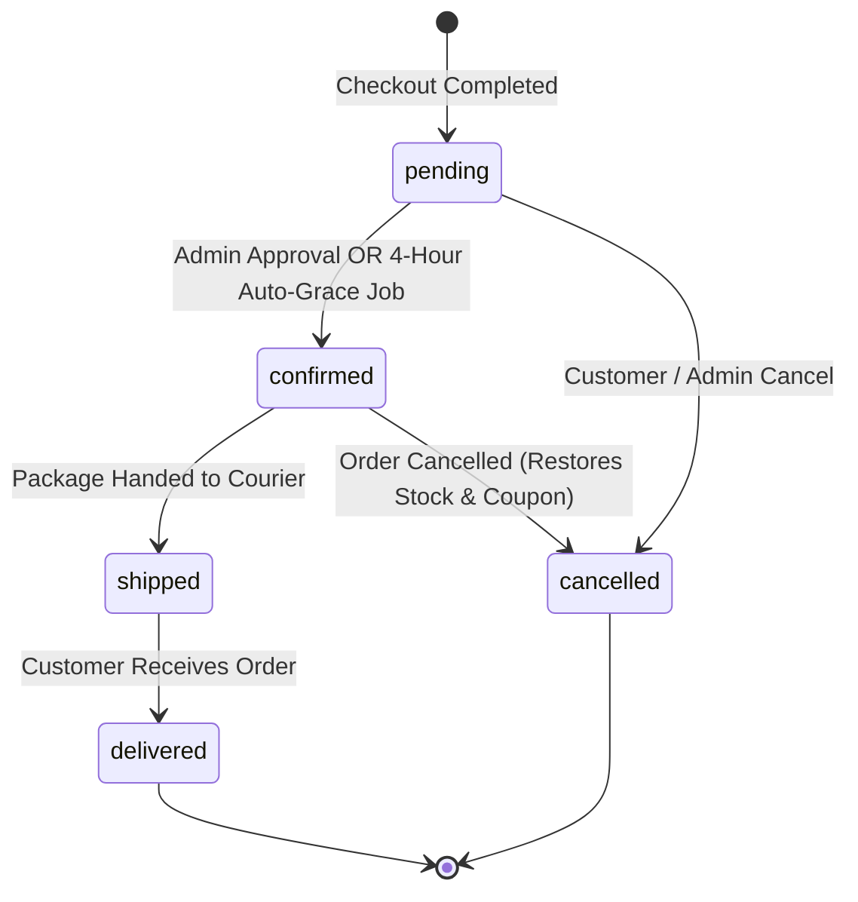

# System Architecture & Technical Specifications

This document records the core architectural decisions, database schemas, order lifecycles, and concurrency contracts for **TechStore / MPOS_Flask**.

---

## 1. Locked Architectural Decisions

1. **Monetary Values (Cents Precision)**
   - All monetary amounts in database columns MUST be stored as integer cents and named `*_cents` (e.g. `price_cents`, `cost_price_cents`, `subtotal_cents`, `total_cents`).
   - Use `helpers.money` functions: `to_cents()`, `from_cents()`, and `format_money()`.
   - External JSON APIs (`/api/*`) maintain backwards-compatibility for frontend clients (e.g. Angular) by returning price as decimal numbers.

2. **Unified User Accounts & Role-Based Access**
   - All accounts (both shoppers and staff/administrators) are stored in the unified `user` table.
   - Roles include `'user'` (regular customer/shopper) and `'admin'` (system administrator).
   - Session keys use `session['user_id']` and `session['role']`.
   - Admin access requires `session['user_id']` AND `session['role'] == 'admin'`.

3. **Guest Checkout Support**
   - Guest checkouts are fully supported: `orders.user_id` is nullable (`NULL` for guest purchases).
   - Customer name, email, phone, and delivery address are captured directly on the `Order` record as an immutable snapshot.

4. **Order Status Lifecycle**
   - Valid order statuses: `pending`, `confirmed`, `shipped`, `delivered`, `cancelled`.
   - Default status upon checkout is `pending`.

5. **Timezone & Timestamps**
   - All database timestamps are stored in timezone-naive UTC generated via `helpers.time.utc_now()`.
   - Display and reporting representations are localized to `Asia/Phnom_Penh` (GMT+7) via `helpers.time.to_local(dt)`.

6. **Product Catalog & Variant Guarantee**
   - Every product in the database is guaranteed to have at least one variant named `"Default"`.
   - Cart items will store and reference `variant_id`.

7. **Concurrency & Inventory Contract**
   - Inventory decrements MUST be executed atomically using a single SQL statement:
     ```sql
     UPDATE product_variants 
     SET stock = stock - :qty 
     WHERE id = :variant_id AND stock >= :qty;
     ```
   - Check the execution `rowcount == 1`.
   - Do NOT use pessimistic `SELECT ... FOR UPDATE` or table locks.

---

## 2. Order Status Flow



---

## 3. Database Schema Reference

| Table Name | Description | Key Columns / Constraints |
| :--- | :--- | :--- |
| `user` | User accounts (admin and customer) | `id`, `username`, `email`, `password`, `role` (default: `'user'`), `profile`, `is_active`, `created_at` |
| `block_logs` | Rate limit & security audit logs | `id`, `ip`, `endpoint`, `methods`, `attempts`, `device`, `create_at` |
| `categories` | Product categories | `id`, `name` (unique), `slug` (unique) |
| `products` | Base product definitions | `id`, `category_id` (FK), `name`, `description`, `image`, `is_active`, `created_at` |
| `product_variants` | Product SKUs and variants | `id`, `product_id` (FK), `sku` (unique), `spec_name`, `price_cents`, `stock`, `low_stock_threshold`, `is_active` |
| `orders` | Sales orders | `id`, `order_number` (unique), `user_id` (FK nullable), `customer_name`, `email`, `phone`, `address`, `status`, `subtotal_cents`, `discount_cents`, `total_cents`, `created_at`. Index on `(status, created_at)` |
| `order_items` | Line items in an order | `id`, `order_id` (FK), `variant_id` (FK nullable SET NULL), `product_name`, `sku`, `spec_name` (snapshots), `qty`, `unit_price_cents`, `line_total_cents` |
| `coupons` | Discount promo codes | `id`, `code` (unique uppercase), `discount_type` ('percent'\|'fixed'), `value`, `min_spend_cents`, `max_discount_cents`, `usage_limit`, `used_count`, `is_active` |
| `coupon_redemptions`| Historical coupon usage | `id`, `coupon_id` (FK), `order_id` (FK), `user_id` (FK nullable), `created_at` |
| `wishlist_items` | User saved items | `id`, `user_id` (FK), `product_id` (FK), `created_at`, UNIQUE(`user_id`, `product_id`) |
| `product_reviews` | Ratings & reviews | `id`, `user_id` (FK), `product_id` (FK), `rating` (CHECK 1-5), `comment`, `is_visible`, `created_at`, UNIQUE(`user_id`, `product_id`) |

---

## 4. Unified Authentication & Access Control

1. **Unified Routes at `/login` and `/register`**
   - Canonical authentication routes: `GET/POST /login` (`front_bp.login`) and `GET/POST /register` (`front_bp.register`).
   - Legacy routes `GET /admin/login` and `GET /admin/register` return HTTP 302 redirects to `/login` and `/register` preserving query parameters.
   - Form processing occurs strictly in `services.auth_service`.
   - Registration creates users with role `'user'` exclusively (ignoring any client-supplied `role` parameter) and auto-authenticates the user.
   - Admin account creation is restricted to admin CRUD in `admin/user.py` or the CLI command `flask create-admin`.

2. **Landing Redirect Logic**
   - **Role `'admin'`**: Redirects to validated `next` parameter if present, otherwise `/admin/dashboard`.
   - **Role `'user'`**: Redirects to validated `next` parameter if present (and not matching `/admin/*`), otherwise `/` (storefront home).

3. **Logout Security**
   - Logout requires `POST /logout` (`front_bp.logout`) with CSRF verification.
   - `GET /admin/logout` redirects to `/` without clearing the session, preventing CSRF image/link injection attacks.

4. **Rate Limiting**
   - Stricter rate limiting is enforced on sensitive endpoints: `@limiter.limit("5 per minute", methods=["POST"])` on `/login` and `/register`.

5. **API Authentication Hardening**
   - `GET /api/users` and `GET /api/user/<id>` require an authenticated administrator session (`session.get('role') == 'admin'`), returning `401 Unauthorized` otherwise to protect user and customer emails.


