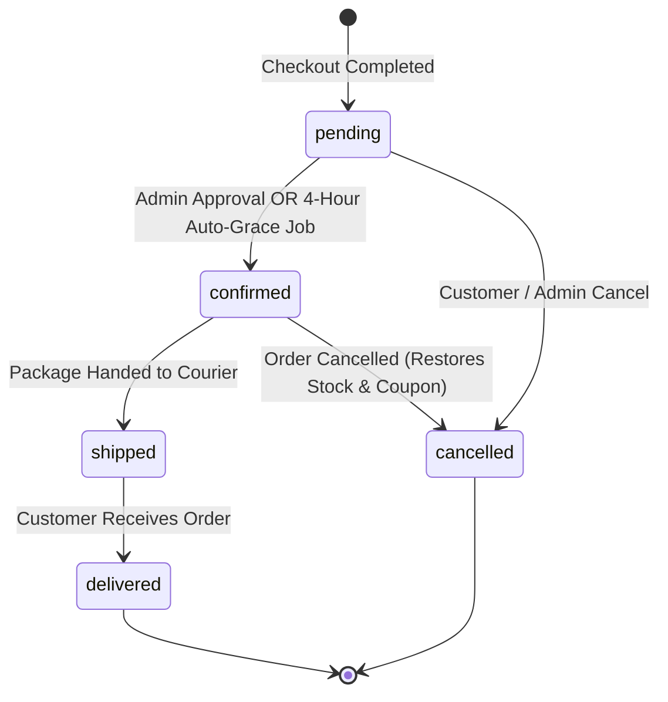

# System Architecture & Technical Specifications

This document records the core architectural decisions, database schemas, order lifecycles, and concurrency contracts for **TechStore / MPOS_Flask**.

---

## 1. Locked Architectural Decisions

1. **Monetary Values (Cents Precision)**
   - All monetary amounts in database columns MUST be stored as integer cents and named `*_cents` (e.g. `price_cents`, `cost_price_cents`, `subtotal_cents`, `total_cents`).
   - Use `helpers.money` functions: `to_cents()`, `from_cents()`, and `format_money()`.
   - External JSON APIs (`/api/*`) maintain backwards-compatibility for frontend clients (e.g. Angular) by returning price as decimal numbers.

2. **Customer vs. Staff Separation**
   - Shoppers are stored in a dedicated `customers` table, isolated from administrative/staff `user` accounts.
   - Customer authentication uses session key `session['customer_id']`.
   - Staff/Admin authentication uses session keys `session['user_id']` and `session['role'] == 'admin'`.
   - Never combine or cross-pollinate `Customer` with `User`.

3. **Guest Checkout Support**
   - Guest checkouts are fully supported: `orders.customer_id` is nullable (`NULL` for guest purchases).
   - Customer name, email, phone, and delivery address are captured directly on the `Order` record as an immutable snapshot.

4. **Order Status Lifecycle**
   - Valid order statuses: `pending`, `confirmed`, `shipped`, `delivered`, `cancelled`.
   - Default status upon checkout is `pending`.

5. **Timezone & Timestamps**
   - All database timestamps are stored in timezone-naive UTC generated via `helpers.time.utc_now()`.
   - Display and reporting representations are localized to `Asia/Phnom_Penh` (GMT+7) via `helpers.time.to_local(dt)`.

6. **Product Catalog & Variant Guarantee**
   - Every product in the database is guaranteed to have at least one variant named `"Default"`.
   - Cart items will store and reference `variant_id`.

7. **Concurrency & Inventory Contract**
   - Inventory decrements MUST be executed atomically using a single SQL statement:
     ```sql
     UPDATE product_variants 
     SET stock = stock - :qty 
     WHERE id = :variant_id AND stock >= :qty;
     ```
   - Check the execution `rowcount == 1`.
   - Do NOT use pessimistic `SELECT ... FOR UPDATE` or table locks.

---

## 2. Order Status Flow



---

## 3. Database Schema Reference

| Table Name | Description | Key Columns / Constraints |
| :--- | :--- | :--- |
| `user` | Admin and staff accounts | `id`, `username`, `email`, `password`, `role` (default: `'user'`), `profile` |
| `block_logs` | Rate limit & security audit logs | `id`, `ip`, `endpoint`, `methods`, `attempts`, `device`, `create_at` |
| `categories` | Product categories | `id`, `name` (unique), `slug` (unique) |
| `products` | Base product definitions | `id`, `category_id` (FK), `name`, `description`, `image`, `is_active`, `created_at` |
| `product_variants` | Product SKUs and variants | `id`, `product_id` (FK), `sku` (unique), `spec_name`, `price_cents`, `stock`, `low_stock_threshold`, `is_active` |
| `customers` | Registered customer accounts | `id`, `name`, `email` (unique), `password_hash`, `phone`, `created_at`, `is_active` |
| `orders` | Sales orders | `id`, `order_number` (unique), `customer_id` (FK nullable), `customer_name`, `email`, `phone`, `address`, `status`, `subtotal_cents`, `discount_cents`, `total_cents`, `created_at`. Index on `(status, created_at)` |
| `order_items` | Line items in an order | `id`, `order_id` (FK), `variant_id` (FK nullable SET NULL), `product_name`, `sku`, `spec_name` (snapshots), `qty`, `unit_price_cents`, `line_total_cents` |
| `coupons` | Discount promo codes | `id`, `code` (unique uppercase), `discount_type` ('percent'\|'fixed'), `value`, `min_spend_cents`, `max_discount_cents`, `usage_limit`, `used_count`, `is_active` |
| `coupon_redemptions`| Historical coupon usage | `id`, `coupon_id` (FK), `order_id` (FK), `customer_id` (FK nullable), `created_at` |
| `wishlist_items` | Customer saved items | `id`, `customer_id` (FK), `product_id` (FK), `created_at`, UNIQUE(`customer_id`, `product_id`) |
| `product_reviews` | Ratings & reviews | `id`, `customer_id` (FK), `product_id` (FK), `rating` (CHECK 1-5), `comment`, `is_visible`, `created_at`, UNIQUE(`customer_id`, `product_id`) |

---

## 4. Security Findings & Considerations for Lead

1. **`/api/users` Public Email Exposure**
   - In `api/user.py`, the endpoints `GET /api/users` and `GET /api/user/<id>` execute `SELECT id, username, email, role, profile FROM user` without authentication or authorization.
   - This publicly exposes administrative and staff email addresses to any unauthenticated client.
   - **Recommendation for Lead**: In a future workstream, restrict `/api/users` to authenticated administrators or sanitize the returned fields (omit `email` and password hashes).
