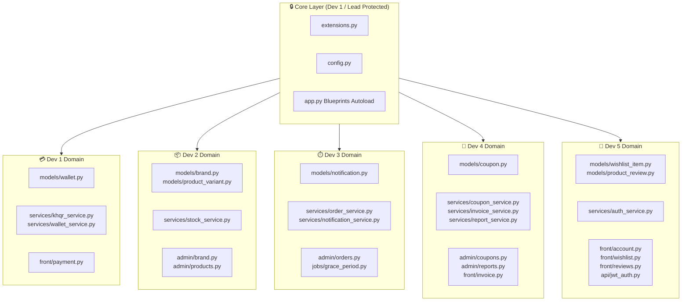

# 👥 Team Task Division & Zero-Conflict Engineering Guide (Team of 5)

**Project:** TechStore / MPOS_Flask  
**Target Branch:** `develop`  
**Team Size:** 5 Full-Stack Engineers  
**Target Completion:** Sprints M1 – M5  

---

## 📌 Table of Contents
1. [Executive Summary & Balancing Strategy](#1-executive-summary--balancing-strategy)
2. [Zero-Conflict Merge Architecture](#2-zero-conflict-merge-architecture)
3. [Unified Folder & File Structure](#3-unified-folder--file-structure)
4. [Detailed Task Division (Developers 1 – 5)](#4-detailed-task-division-developers-1--5)
   - [Developer 1 (Lead): Bakong KHQR, Currency & Customer Wallet](#-developer-1-team-lead--payments-core-architect)
   - [Developer 2: Product Variants, Brands, Stock & Search](#-developer-2-catalog-inventory--brand-specialist)
   - [Developer 3: Orders, Grace Period Automation & In-App Notifications](#-developer-3-orders-scheduler--notifications-engineer)
   - [Developer 4: Coupons, PDF Invoicing & Accounting Exports](#-developer-4-promotions-invoicing--accounting-analyst)
   - [Developer 5: Customer Portal, Wishlist, Reviews & JWT Security](#-developer-5-customer-portal-social-commerce--api-security)
5. [Git Workflow & Merge Rules](#5-git-workflow--merge-rules)
6. [Team Verification & Definition of Done](#6-team-verification--definition-of-done)

---

## 1. Executive Summary & Balancing Strategy

To deliver all requirements without developer friction or merge conflicts, the codebase is partitioned into **5 mutually exclusive functional domains**. 

Each engineer owns specific models, services, blueprints, and template directories. Shared foundation files (`app.py`, `extensions.py`, `templates/admin/master.html`) are strictly guarded using pluggable registration patterns and Jinja2 block inheritance.

### 📊 Workload Fairness Matrix

| Teammate | Primary Domain | Core Features Assigned | Complexity Points |
| :--- | :--- | :--- | :---: |
| **Dev 1 (Lead)** | **Payments & Ledger** | • NBC Bakong KHQR Dynamic QR (`bakong-khqr`)<br>• Real-time `/api/payment/check/<md5>` Polling<br>• Authoritative KHR Dual Currency Engine (`khr_format`, `usd_format`)<br>• Customer Wallet & Split Payment Engine (3-way checkout) | **9 / 10** |
| **Dev 2** | **Catalog & Inventory** | • Product Variants & Specs (`product_variants`)<br>• Atomic Stock Decrement SQL & Restock Contract<br>• Low-Stock Telegram Threshold Alerts<br>• Brand Management CRUD (Logo upload, slug generator)<br>• Real-Time Search Keyword Highlighting (`MarkupSafe`) | **9 / 10** |
| **Dev 3** | **Orders & Automation** | • Order Lifecycle Management (`pending` → `confirmed` → `shipped` → `delivered` → `cancelled`)<br>• 4-Hour Automated Grace Period Confirmer (`Flask-APScheduler`)<br>• Grace Period Telegram Alert Dispatcher<br>• In-App Notification System (`Notification` model + navbar bell) | **9 / 10** |
| **Dev 4** | **Finance & Accounting** | • Coupon & Promotional Discount Engine (Percent & Fixed, validation & redemption)<br>• Downloadable PDF Invoice / Receipt (`reportlab`)<br>• One-Click CSV & Excel Accounting Export (`openpyxl`)<br>• Stock Valuation & Daily Revenue Reports | **9 / 10** |
| **Dev 5** | **Customer & Security** | • Customer Account & Profile (`/account`, avatar resize, password update)<br>• Customer Wishlist ("Save for Later")<br>• Customer Product Reviews & 1–5 Star Ratings<br>• JWT API Authentication (`pyjwt`, `@jwt_required`, `@jwt_admin_required`) | **9 / 10** |

---

## 2. Zero-Conflict Merge Architecture

Merge conflicts occur when multiple developers edit the same file, modify identical lines in shared templates, or run concurrent migrations. We eliminate conflicts through **5 structural rules**:



### 🛡️ The 5 Golden Rules
1. **Strict File Ownership:** No engineer creates or edits files outside their assigned list.
2. **Service Decoupling:** Modules communicate through function calls in `services/`, never through direct database modifications across domain boundaries.
3. **Isolated Template Subdirectories:** Every teammate works in dedicated template subfolders (`templates/admin/<feature>/` and `templates/front/<feature>/`).
4. **No Direct Edits to Shared Master Templates:** Shared navigation bars use hook include blocks (e.g., ``), maintained via separate files.
5. **No Parallel `flask db migrate`:** Developer 1 applies model migrations centrally or reviews migration scripts before merging to prevent Alembic head conflicts.

---

## 3. Unified Folder & File Structure

```text
Flask/
├── admin/                         # Admin Portal
│   ├── auth.py                    # [Shared Auth]
│   ├── block_log.py               # [Existing Security]
│   ├── brand.py                   # 👤 DEV 2: Brand CRUD & logo management
│   ├── coupons.py                 # 👤 DEV 4: Coupon Management CRUD
│   ├── dashboard.py               # 👤 DEV 1 & DEV 4: Executive KPI & Valuation Cards
│   ├── orders.py                  # 👤 DEV 3: Order Management & Status Modals
│   ├── products.py                # 👤 DEV 2: Product & Variant Stock Management
│   ├── reports.py                 # 👤 DEV 4: Sales, Valuation & Daily Excel/CSV Exports
│   ├── reviews.py                 # 👤 DEV 5: Customer Reviews Moderation
│   ├── user.py                    # [Existing Admin Users]
│   └── variants.py                # 👤 DEV 2: Variant SKUs, Specs & Price CRUD
├── api/                           # RESTful Engine
│   ├── auth.py                    # 👤 DEV 5: JWT Login & Token Dispatch
│   ├── jwt_auth.py                # 👤 DEV 5: @jwt_required & @jwt_admin_required Decorators
│   ├── payment.py                 # 👤 DEV 1: /api/payment/check/<md5> Polling API
│   ├── product.py                 # 👤 DEV 2 & 5: Public JSON Endpoints
│   └── user.py                    # [Existing User API]
├── front/                         # Customer Storefront
│   ├── account.py                 # 👤 DEV 5: Profile, Password Change & Order History
│   ├── auth.py                    # [Shared Storefront Auth]
│   ├── cart.py                    # [Existing Cart Core]
│   ├── checkout.py                # 👤 DEV 1: Split-Payment & Bakong KHQR Checkout Controller
│   ├── coupon.py                  # 👤 DEV 4: Live AJAX Coupon Validation
│   ├── home.py                    # [Existing Home]
│   ├── invoice.py                 # 👤 DEV 4: Downloadable PDF Invoice / Receipt (/invoice/<id>/pdf)
│   ├── notification.py            # 👤 DEV 3: Customer Notifications Center (/notifications)
│   ├── product.py                 # 👤 DEV 2: Catalog with Real-Time Highlight Search
│   ├── reviews.py                 # 👤 DEV 5: Submit Product Review & Ratings
│   └── wishlist.py                # 👤 DEV 5: Wishlist Toggle & "Save for Later" View
├── helpers/                       # Core Helpers
│   ├── currency.py                # 👤 DEV 1: KHR / USD Formatters & Global Context Processors
│   ├── highlight.py               # 👤 DEV 2: MarkupSafe XSS-Clean Search Highlighter
│   ├── money.py                   # [Existing Cents Helpers]
│   ├── telegram.py                # [Existing Telegram Core Alert Dispatcher]
│   ├── time.py                    # [Existing UTC & Cambodia Local Time Helpers]
│   └── upload.py                  # [Existing Pillow Avatar Resizer]
├── jobs/                          # APScheduler Background Workers
│   └── grace_period.py            # 👤 DEV 3: 4-Hour Auto-Confirm & Telegram Alert Job
├── models/                        # SQLAlchemy Domain Models
│   ├── block_log.py               # [Existing BlockLog]
│   ├── brand.py                   # 👤 DEV 2: Brand Model
│   ├── category.py                # [Existing Category]
│   ├── coupon.py                  # 👤 DEV 4: Coupon Model
│   ├── coupon_redemption.py       # 👤 DEV 4: Coupon Redemption History
│   ├── notification.py            # 👤 DEV 3: In-App Notification Model
│   ├── order.py                   # 👤 DEV 3: Order Model (with MD5, status, timestamps)
│   ├── order_item.py              # [Existing OrderItem]
│   ├── product.py                 # [Existing Product]
│   ├── product_review.py          # 👤 DEV 5: ProductReview Model (1-5 stars)
│   ├── product_variant.py         # 👤 DEV 2: ProductVariant Model (SKU, spec, stock)
│   ├── user.py                    # [Existing User + balance attribute]
│   ├── wallet.py                  # 👤 DEV 1: WalletTransaction Model
│   └── wishlist_item.py           # 👤 DEV 5: WishlistItem Model
├── services/                      # Decoupled Business Logic Services
│   ├── auth_service.py            # 👤 DEV 5: Authentication & Session Verification
│   ├── coupon_service.py          # 👤 DEV 4: Discount Verification & Redemption Rules
│   ├── invoice_service.py         # 👤 DEV 4: ReportLab PDF Invoice Builder
│   ├── khqr_service.py            # 👤 DEV 1: NBC Bakong EMVCo QR & Verification Gateway
│   ├── notification_service.py    # 👤 DEV 3: In-App & Multi-Channel Alert Dispatcher
│   ├── order_service.py           # 👤 DEV 3: Order State Machine & Cancellation Rules
│   ├── report_service.py          # 👤 DEV 4: openpyxl Excel & CSV Generator
│   ├── stock_service.py           # 👤 DEV 2: Atomic Decrement & Telegram Low-Stock Dispatch
│   └── wallet_service.py          # 👤 DEV 1: Store Credit Ledger & Split Calculations
└── templates/                     # Jinja2 Layouts & Partials
    ├── admin/
    │   ├── brand/                 # 👤 DEV 2: Brand CRUD templates
    │   ├── coupons/               # 👤 DEV 4: Coupon CRUD templates
    │   ├── orders/                # 👤 DEV 3: Order listing & status modal templates
    │   ├── products/              # 👤 DEV 2: Variant and stock templates
    │   ├── reports/               # 👤 DEV 4: Accounting exports dashboard templates
    │   └── reviews/               # 👤 DEV 5: Review moderation templates
    └── front/
        ├── account/               # 👤 DEV 5: User profile & order list templates
        ├── invoice/               # 👤 DEV 4: HTML receipt / print preview templates
        ├── notifications/         # 👤 DEV 3: Notification center templates
        ├── partials/
        │   ├── _coupon_box.html       # 👤 DEV 4: Checkout coupon input
        │   ├── _rating_stars.html     # 👤 DEV 5: Dynamic 1-5 star icons
        │   ├── _reviews.html          # 👤 DEV 5: Reviews list & submit form
        │   └── _wishlist_button.html  # 👤 DEV 5: Heart toggle button
        └── wishlist/              # 👤 DEV 5: Wishlist gallery template
```

---

## 4. Detailed Task Division (Developers 1 – 5)

---

### 💳 Developer 1 (Team Lead / Payments & Core Architect)

**Mission:** Build the payment backbone, currency standard, customer wallet ledger, and coordinate repository stability.

#### Key Features & Deliverables
1. **NBC Bakong KHQR Payment Engine:**
   - Integrate `bakong-khqr` SDK.
   - Generate dynamic 30-minute EMVCo QR code base64 string (`data:image/png;base64,...`) for merchant (`thoeung_sereymongkol@bkrt`).
   - Tag 54 KHR compliance: integer rounding rule `int(round(amount))`.
   - Implement real-time verification polling endpoint `GET /api/payment/check/<md5>` invoking NBC `/check_transaction_by_md5`.
   - Gracefully handle sandbox developer quota codes (`17, 18, 19`).
2. **Authoritative KHR Dual Currency Engine:**
   - Authoritative DB single-source-of-truth: Cambodian Riel (integer KHR).
   - Jinja2 filters: `khr_format(value)` (e.g. `42,000 ៛`) and `usd_format(value)` (fixed rate `1 USD = 4,000 KHR`).
   - Context processor injecting `khr_rate`, `khr_format`, `usd_format` globally into all templates.
3. **Customer Wallet & Split Payments Engine:**
   - Create `WalletTransaction` model (`id`, `user_id`, `order_id`, `amount`, `balance_after`, `tx_type`, `created_at`).
   - Implement 3-branch checkout state machine in `front/checkout.py`:
     1. **100% Wallet Balance:** If balance $\ge$ total, instantly clear order without banking steps.
     2. **100% Bakong KHQR:** If balance $= 0$, render full dynamic KHQR.
     3. **Split Payment:** Deduct maximum available balance, generate dynamic KHQR only for remaining due.

#### Files Owned Exclusively
- `models/wallet.py`
- `services/khqr_service.py`
- `services/wallet_service.py`
- `helpers/currency.py`
- `api/payment.py`
- `front/checkout.py` (Checkout controller & payment gateway flow)

#### Acceptance Test Criteria
- [ ] Generating KHQR produces valid base64 PNG string without disk I/O.
- [ ] `/api/payment/check/<md5>` responds with `{paid: true/false}`.
- [ ] Split payment correctly creates negative `WalletTransaction` record and updates `user.balance`.
- [ ] `{{ 40000 | khr_format }}` displays `40,000 ៛` and `{{ 40000 | usd_format }}` displays `≈ $10.00`.

---

### 📦 Developer 2 (Catalog, Inventory & Brand Specialist)

**Mission:** Deliver flexible product variants, robust atomic inventory control, low-stock proactive alerts, brand management, and XSS-safe search.

#### Key Features & Deliverables
1. **Product Variants & SKUs:**
   - Multi-variant architecture linked to `products`: `ProductVariant` model (`sku`, `spec_name`, `price_cents`, `stock`, `low_stock_threshold`, `is_active`).
   - Admin variant management: Add/edit specs (e.g. "16GB RAM / 512GB SSD", "32GB RAM / 1TB SSD") per product.
2. **Atomic Stock Decrement & Concurrency Safety:**
   - Implement `decrement_stock_atomic(variant_id, qty)` in `services/stock_service.py`:
     ```sql
     UPDATE product_variants SET stock = stock - :qty WHERE id = :id AND stock >= :qty
     ```
   - Verify `rowcount == 1`. Absolutely no pessimistic table locks.
   - Implement `restore_stock(variant_id, qty)` for cancelled or expired orders.
3. **Low-Stock Telegram Threshold Alerts:**
   - When variant stock reaches or drops below `low_stock_threshold` (default: 5), trigger automated background Telegram notification to `@SETEC_PP_SHOP` with SKU, product name, remaining quantity, and restock link.
4. **Brand Management CRUD:**
   - Model `Brand` (`id`, `name`, `slug`, `description`, `logo`, `website`, `created_at`).
   - Admin controller `admin/brand.py` with List, Add, Edit, Delete (safe disassociation: sets `product.brand_id = NULL` on deletion).
   - Secure logo upload handler.
5. **Real-Time Search Keyword Highlighting:**
   - Safe `highlight_query(value, query)` Jinja2 filter using `markupsafe.Markup` and regex split parentheses to prevent XSS script injection.
   - CSS styling `.search-highlight` with amber badge.

#### Files Owned Exclusively
- `models/brand.py`
- `models/product_variant.py`
- `services/stock_service.py`
- `helpers/highlight.py`
- `admin/brand.py`
- `admin/products.py`
- `admin/variants.py`
- `templates/admin/brand/*`
- `templates/admin/products/*`

#### Acceptance Test Criteria
- [ ] Two simultaneous checkouts cannot oversell inventory (atomic update verified).
- [ ] Stock decrementing below threshold immediately dispatches Telegram warning card.
- [ ] Deleting a brand sets product `brand_id` to null without cascading deletion of products.
- [ ] Searching `<script>alert(1)</script>` in storefront properly escapes HTML tags and highlights matches.

---

### ⏱️ Developer 3 (Orders, Scheduler & Notifications Engineer)

**Mission:** Control the entire order status lifecycle, 4-hour grace period background automation, and the in-app notification center.

#### Key Features & Deliverables
1. **Order State Machine & Admin Management:**
   - Manage order transitions: `pending` $\rightarrow$ `confirmed` $\rightarrow$ `shipped` $\rightarrow$ `delivered` $\rightarrow$ `cancelled`.
   - Admin order list with status filters, date range filter, and customer contact lookup.
   - Luxury order detail modal: Shipping address, itemized breakdown, payment method, Bakong MD5 transaction hash with one-click copy button.
2. **Automated Grace Period Confirmer (4-Hour Auto-Confirm):**
   - Implement `auto_confirm_pending_orders_job()` in `jobs/grace_period.py` using `Flask-APScheduler`.
   - Query orders where `status == 'pending'` and `created_at <= (utc_now - 4 hours)`.
   - Transition status to `'confirmed'`, set `confirmed_at = utc_now()`.
   - Dispatch Telegram order confirmation alert.
3. **Customer 4-Hour Cancellation & Restock Window:**
   - Customers can self-service cancel orders within 4 hours directly from their account.
   - Cancellation triggers:
     1. Status set to `'cancelled'`.
     2. Automatic stock restoration via `stock_service.restore_stock()`.
     3. 100% store credit refund credited back to `user.balance` via `wallet_service`.
     4. Alert to Telegram admin channel.
4. **In-App Notification Engine:**
   - Model `Notification` (`id`, `user_id`, `title`, `message`, `category`, `link`, `is_read`, `created_at`).
   - Dispatch helper `notify_user(user_id, title, message, category, link)`.
   - Frontend notification drop-down / center with live unread counter bell icon in navbar.

#### Files Owned Exclusively
- `models/order.py` (Coordinate modifications with Dev 1)
- `models/notification.py`
- `services/order_service.py`
- `services/notification_service.py`
- `jobs/grace_period.py`
- `admin/orders.py`
- `front/notification.py`
- `templates/admin/orders/*`
- `templates/front/notifications/*`

#### Acceptance Test Criteria
- [ ] Orders pending $> 4$ hours are automatically converted to `confirmed` on scheduler run.
- [ ] Customer cancellation within 4h successfully restores variant stock and returns funds to wallet.
- [ ] Cancellation after 4h is prohibited and displays an error message.
- [ ] Emitted notification increments navbar bell badge and links to order details.

---

### 📑 Developer 4 (Promotions, Invoicing & Accounting Analyst)

**Mission:** Drive business revenue logic through promo discounts, instant PDF receipt generation, and executive Excel/CSV accounting exports.

#### Key Features & Deliverables
1. **Coupon & Promotional Discount Engine:**
   - Validate and redeem coupons: `validate_coupon(code, subtotal_cents, user_id)` and `redeem(code, order_id, user_id)`.
   - Support `percent` (e.g. 10% off up to max discount) and `fixed` (e.g. $5.00 off on min spend $50.00).
   - Usage limits (`usage_limit`, `used_count`) and expiry date enforcement.
   - Admin coupon CRUD in `admin/coupons.py` (Add, Edit, Delete, Toggle active).
   - Live AJAX `/coupon/preview` validation endpoint with coupon box UI partial.
2. **Downloadable PDF Invoice / Receipt Generator:**
   - Implement `services/invoice_service.py` using **ReportLab**.
   - Professional PDF invoice template: Store header/logo, invoice #, issue date, customer details, itemized table (SKU, name, spec, unit price, quantity, line total), subtotal, discount, tax, final total in USD & KHR.
   - Secure customer download route: `GET /invoice/<order_number>/pdf`.
3. **One-Click CSV & Excel Accounting Export Engine:**
   - Implement `services/report_service.py` using **openpyxl** and Python `csv`.
   - Admin reporting dashboard `admin/reports.py`:
     - **Sales Records Export:** Date range filter, order #, customer, payment method, gross revenue, discount, net revenue.
     - **Daily Revenue Breakdown:** Grouped by date, total orders, completed vs cancelled revenue.
     - **Inventory Stock Valuation:** Live aggregate of all warehouse variants (`SUM(stock * price_cents)`), stock status, and low-stock warnings.

#### Files Owned Exclusively
- `models/coupon.py`
- `models/coupon_redemption.py`
- `services/coupon_service.py`
- `services/invoice_service.py`
- `services/report_service.py`
- `admin/coupons.py`
- `admin/reports.py`
- `front/coupon.py`
- `front/invoice.py`
- `templates/admin/coupons/*`
- `templates/admin/reports/*`
- `templates/front/partials/_coupon_box.html`

#### Acceptance Test Criteria
- [ ] Expired or over-limit coupons are rejected with clear user error messages.
- [ ] Generating PDF returns a valid PDF binary with correct content disposition header (`attachment; filename=Invoice-...pdf`).
- [ ] Exporting Excel generates valid `.xlsx` spreadsheet matching database sales numbers.
- [ ] Stock valuation report accurately aggregates inventory costs and quantities.

---

### 👤 Developer 5 (Customer Portal, Social Commerce & API Security)

**Mission:** Deliver the authenticated customer profile, interactive social features (Wishlist, Reviews), and stateless JWT security for mobile/SPA clients.

#### Key Features & Deliverables
1. **Customer Account & Order History Portal:**
   - Complete `/account` view: Edit profile details (username, phone, delivery address, email with uniqueness validation).
   - Profile picture upload with Pillow thumbnail processing (`200x200` thumb).
   - Password update with current-password verification.
   - Customer order history view `/account/orders` and `/account/orders/<order_number>`.
2. **Customer Wishlist ("Save for Later"):**
   - Model `WishlistItem` (`user_id`, `product_id`, `created_at`, Unique Constraint).
   - Storefront AJAX toggle button `POST /wishlist/toggle/<product_id>`.
   - Customer wishlist view `GET /wishlist` with "Move to Cart" button.
3. **Customer Product Reviews & Star Ratings:**
   - Model `ProductReview` (`user_id`, `product_id`, `rating` 1–5, `comment`, `is_visible`, `created_at`).
   - Verified Purchase check: only customers who purchased the item can review it.
   - Reusable Jinja2 partials: `_rating_stars.html` and `_reviews.html`.
   - Admin moderation view `admin/reviews.py` (Approve, Hide, Delete spam reviews).
4. **JWT API Authentication Engine:**
   - Dedicated JWT module in `api/jwt_auth.py` using `pyjwt`.
   - Functions `create_access_token(user)` and `decode_access_token(token)` with 24-hour expiration.
   - Decorators `@jwt_required` and `@jwt_admin_required` setting `g.jwt_user` and `g.current_user`.
   - REST login endpoint `POST /api/auth/login` returning Bearer token for Flutter/Angular apps.

#### Files Owned Exclusively
- `models/wishlist_item.py`
- `models/product_review.py`
- `services/auth_service.py`
- `api/jwt_auth.py`
- `api/auth.py`
- `front/account.py`
- `front/wishlist.py`
- `front/reviews.py`
- `admin/reviews.py`
- `templates/front/account/*`
- `templates/front/wishlist/*`
- `templates/front/partials/_rating_stars.html`
- `templates/front/partials/_reviews.html`
- `templates/front/partials/_wishlist_button.html`
- `templates/admin/reviews/*`

#### Acceptance Test Criteria
- [ ] Customer can update profile and upload avatars without affecting other users.
- [ ] Clicking wishlist icon dynamically toggles item status via AJAX.
- [ ] Submitting a rating calculates average stars on the product page.
- [ ] API endpoints protected by `@jwt_required` reject requests lacking a valid Bearer token with HTTP 401.

---

## 5. Git Workflow & Merge Rules

To guarantee a clean git tree without conflicts:

### 🌿 Branching Standard
Each developer branches directly from `develop`:
```bash
git checkout develop
git pull origin develop
git checkout -b feature/dev<1-5>-<feature-slug>
```

- **Dev 1:** `feature/dev1-bakong-wallet-currency`
- **Dev 2:** `feature/dev2-variants-brands-stock`
- **Dev 3:** `feature/dev3-orders-grace-notifications`
- **Dev 4:** `feature/dev4-coupons-invoices-reports`
- **Dev 5:** `feature/dev5-account-wishlist-jwt`

### 🔄 Pre-Merge Rebase Checklist (Before PR)
Never merge directly into `develop`. Always rebase:
```bash
# 1. Fetch latest changes
git fetch origin develop

# 2. Rebase feature branch on top of develop
git rebase origin/develop

# 3. Resolve any conflicts in your assigned files
# 4. Run tests to confirm zero regressions
pytest

# 5. Push feature branch and submit Pull Request
git push origin feature/dev<1-5>-<feature-slug>
```

---

## 6. Team Verification & Definition of Done

A task is considered **DONE** only when:
1. **Code Standards:** Integer cents / authoritative KHR adhere to architectural contracts.
2. **CSRF Safety:** Every state-changing HTML form includes `<input type="hidden" name="csrf_token" value="{{ csrf_token() }}"/>`.
3. **No Unhandled Crashes:** Database operations are wrapped with proper exception logging; fail-safe `db.session.rollback()` is present.
4. **Unit / Integration Tests:** Test cases pass via `pytest`.
5. **Team Lead Code Review:** Pull Request approved by Developer 1 (Lead).

